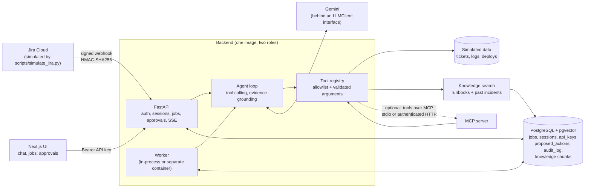
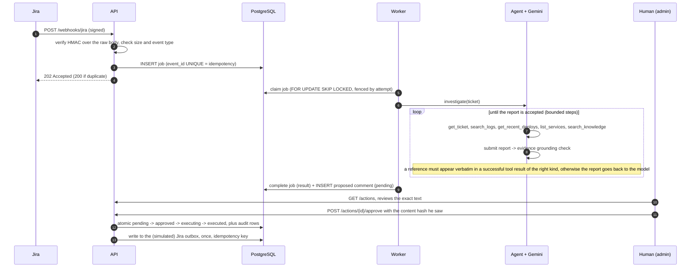

# Architecture

How the pieces fit, where the trust boundaries are, and why each major decision was made. Data sources are simulated (JSON scenarios); everything around the agent is real. Numbers quoted here come from the test suite, the evaluation runs and the container checks described in the other documents.

## 1. Components

- **One agent, two entry points.** A Jira "Bug created" event and a chat message end up in the same agent loop (`app/agent/loop.py`). Jira goes through a durable queue and a worker; chat goes through sessions with streaming.
- **The model proposes, the backend executes.** The model only emits tool-call requests. Every call goes through an allowlist registry that validates arguments and caps result sizes. Nothing the model writes reaches an external system without passing a human.
- **Read-only by construction.** The agent holds no write credentials. The only write path is "propose a Jira comment", executed after human approval.

## 2. One automatic investigation, end to end

Failure handling along the way: transient model errors are retried with exponential backoff, bad data fails permanently without retrying, a job whose worker disappeared is reclaimed after its lease, and a worker that is shut down puts its job back without using an attempt.

## 3. Trust boundaries

Everything the model reads is treated as untrusted data, and so is the model's output.

| Untrusted input | Where it can hurt | Control |
|---|---|---|
| Webhook body | forged events, huge payloads | HMAC over the raw body with constant-time comparison, fail closed without a secret, size limit, uniform status codes chosen for Jira's retry rules |
| Ticket text, logs, runbooks | prompt injection that steers the agent | the agent is read-only; the model's claims must be backed by verbatim evidence; the posted comment is rendered from a fixed template with markup neutralized; a human approves the exact text |
| The model's report | fabricated evidence | evidence grounding in code (not in the prompt), source type bound to the tool that may supply it, too-short references rejected, bounded retries |
| An MCP server | malicious tool descriptions, extra tools, oversized or endless results | client-side allowlist, read-only requirement, truncated descriptions, schema/result/time/page limits, no sampling callbacks, tool source is server configuration and never request-selectable |
| API callers | impersonation, session guessing | hashed keys with roles, uniform 401, 404 (not 403) for someone else's session, fail closed when the database is down |
| Traces and logs | leaking content into observability systems | spans carry metadata only, all attributes sanitized, the session id is hashed |

## 4. Data model (PostgreSQL)

| Table | Purpose | Notable design |
|---|---|---|
| `investigation_jobs` | durable queue and results | `event_id` UNIQUE, status check constraint, partial indexes, lease and fencing columns |
| `chat_sessions` | conversation state | full model history as JSON (including provider raw objects), `version` for optimistic locking, `busy_until` + token as a lease, `agent_variant` fixed at creation |
| `api_keys` | authentication | only a SHA-256 hash of the secret, roles, expiry, revocation, unique active name |
| `proposed_actions` | write actions awaiting approval | content hash, expiry, atomic state machine, unique per job |
| `audit_log` | who did what | append-only, enforced by triggers that reject update, delete and truncate |
| `jira_outbox` | simulated Jira | idempotency key, so a retry cannot post twice |
| `knowledge_documents`, `knowledge_chunks` | RAG | `vector(768)` with an HNSW cosine index; ingestion swaps everything in one transaction |

Schema creation is idempotent and guarded by a Postgres advisory lock, because several instances starting together would otherwise race.

## 5. Key decisions and trade-offs

| Decision | Alternatives | Why this one | What it costs |
|---|---|---|---|
| Hand-written agent loop (plus an SDK variant for comparison) | LangGraph, framework function calling | every step is visible and controllable: grounding checks, rollback, step limits, tracing and approval hooks go exactly where needed | more code to own |
| Evidence verified in code | stricter prompts | prompts proved unreliable (the model kept citing tool names); code is testable and cannot be talked out of it | a verbatim rule can reject a correct paraphrase (it never did with real Gemini: 0 rejections among the 126 reports produced in 129 evaluation runs) |
| Postgres as the job queue | Redis, RabbitMQ, Kafka | jobs must be durable and queryable anyway; one fewer component; volume is minutes apart | would be replaced if throughput grew by orders of magnitude |
| pgvector in the same Postgres | a dedicated vector database | corpus is small; transactional ingestion; filters and joins in SQL | HNSW post-filtering needs care (the inner query must stay a pure ANN query) |
| Pure vector search, no hybrid | BM25 + vector with rank fusion | measured: hybrid was worse than pure vector on this corpus (hit@3 0.94 vs 1.00) | conclusion is limited by a small, author-labeled query set |
| Sessions in Postgres with lease + version | sticky routing, in-process locks | several instances can serve one session; a crashed holder's lease just expires; a slow instance cannot overwrite a newer one | extra queries per turn |
| API keys instead of OAuth | an identity provider | enough for a service-to-service and operator tool; shows the mechanics (hashing, roles, constant time) | no SSO, key kept in `sessionStorage` in the browser |
| Human approval for writes | autonomous write-back | the text derives from untrusted data; approval is bound to a content hash so what is approved is what is sent | a human is in the loop |
| MCP: stdio and authenticated HTTP | only direct calls | standard way to expose tools to other hosts; the client side stays defensive | per-call latency (about 12x in memory, 66x over stdio, measured; small next to a model call) |
| Evaluation with baselines, a held-out set and a paired sign test | accuracy percentage only | a number means nothing without a floor and a ceiling; 30 noisy runs need paired comparison | synthetic scenarios, keyword scorer |
| OpenTelemetry with sanitized attributes | plain logs | one model for traces, metrics and logs; vendor neutral | an extra dependency (a no-op when unconfigured) |

## 6. Failure modes and how they are handled

| Failure | Behavior |
|---|---|
| Model returns 429/503 | retried with exponential backoff; in the queue, the job is retried later; in evaluation, counted as an error (never dropped) |
| Model never submits a report | bounded by a step limit, then the turn fails and is rolled back (history restored) |
| Model fabricates a citation | report rejected with the failing evidence; after two rejections the turn fails rather than delivering an untraceable conclusion |
| Database down | uniform 503 for protected endpoints (fail closed); chat and queue features degrade, `/health` stays a pure liveness check |
| Worker crashes mid-job | lease expires, job reclaimed; fencing stops the old worker from overwriting the new one's result |
| Client disconnects mid-stream | agent task cancelled, history rolled back, session lease released (in a shielded scope, because a cancelled task would otherwise cancel its own cleanup) |
| Two admins approve at once | one atomic `UPDATE ... WHERE status = 'pending'` wins; the other gets 409; the comment is posted once |
| Several instances start together | advisory lock on schema creation |
| Stuck worker (event loop blocked) | heartbeat goes stale, container healthcheck fails, the orchestrator can restart it |
| SIGTERM | uvicorn is PID 1 and shuts down gracefully (worker stops first, then the pool); verified: exit 0 in under a second |

## 7. Operations

- **Containers:** multi-stage images, non-root user, no secrets or test tools inside, `ENVIRONMENT=production` refuses unsafe settings at startup.
- **CI:** backend tests against a real pgvector database (a missing database fails the run instead of skipping tests), frontend lint, type check, tests and build, a smoke test of the real containers, a non-blocking dependency audit.
- **Observability:** traces (`job.process` > `agent.turn` > `llm.generate` and `tool.execute`), metrics, JSON logs that carry `trace_id`.

## 8. What would change for a real deployment

1. Replace the three simulated tool back ends with real Jira, log and Git/CI connectors, each with its own read-only credential held by the tool (never by the model).
2. Vertex AI (service-account identity, no API key to store) behind the existing `LLMClient` interface.
3. A cookie-based session in place of the API key in the browser, SSO for operators.
4. A real migration tool (Alembic) once columns change; a database role for the audit log that can only insert and select.
5. Rate limiting, a load test, image scanning, pinned base-image digests and pinned action SHAs.
6. A larger and partly human-written evaluation set from real incidents; an LLM judge as a second opinion on disputed cases.
